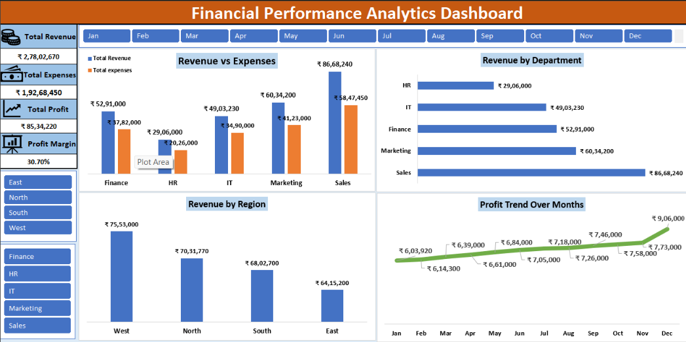

# 📊 Financial Performance Analytics

An interactive Excel dashboard designed to analyze financial performance across departments, regions, and months.

## 📸 Dashboard Preview

## 🛠️ Tools & Technologies

- Microsoft Excel
- Pivot Tables
- Pivot Charts
- Slicers
- Data Analysis
- Dashboard Design

## 📈 Dashboard Features

- KPI tracking: Total Revenue, Total Expenses, Total Profit and Profit Margin.
- Revenue vs. Expenses by Department.
- Revenue Analysis by Department and Region.
- Monthly Profit Trend Analysis.
- Interactive filters for Month, Region and Department.

## 🔍 Key Business Insights

- **Total Revenue:** ₹2,78,02,670.
- **Total Expenses:** ₹1,92,68,450.
- **Total Profit:** ₹85,34,220.
- **Profit Margin:** 30.70%.
- **Regional Performance:** West recorded the highest revenue.
- **Departmental Performance:** Sales generated the highest revenue.

## 📁 Project File

[Download Excel Workbook](financial_performance_analytics.xlsx)

## 👤 Author

**Suleman Gani**

[GitHub](https://github.com/suleman-gani) | [LinkedIn](https://linkedin.com/in/suleman-gani-3a9a62392)
